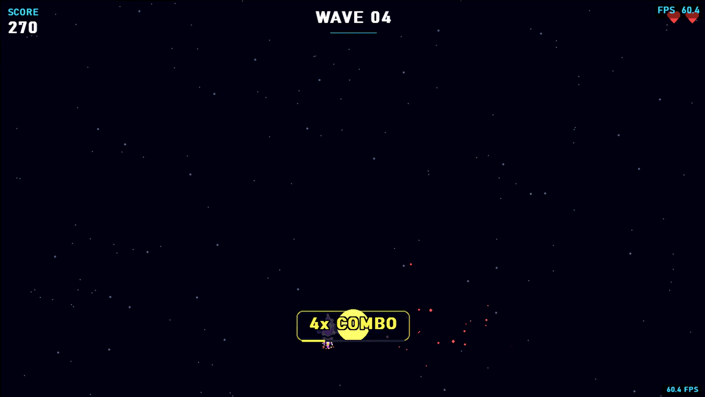
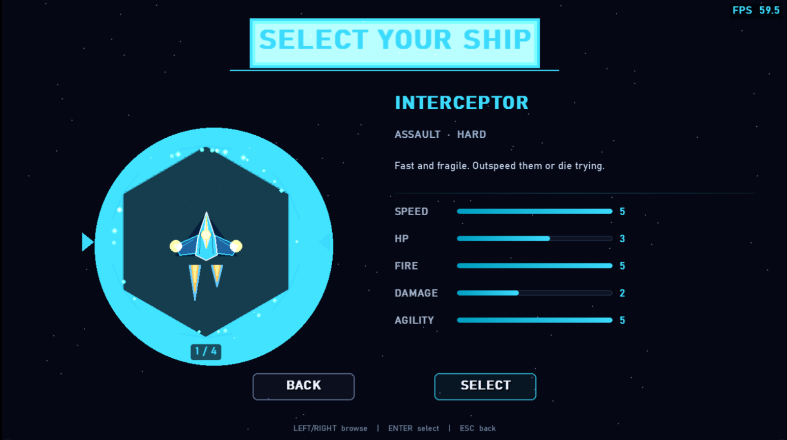
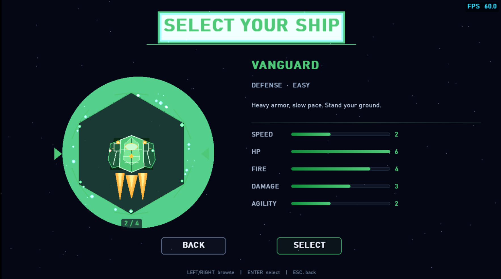
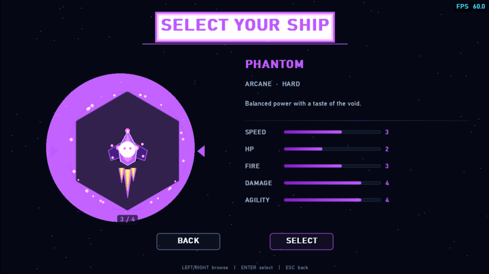
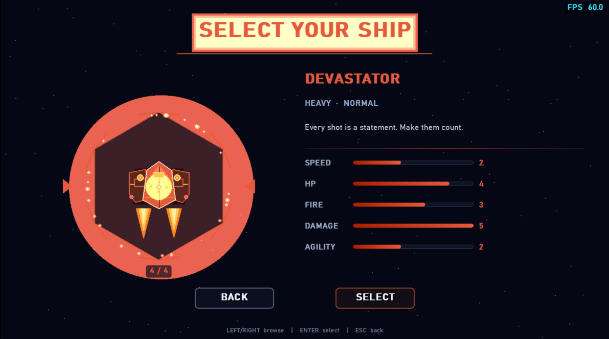
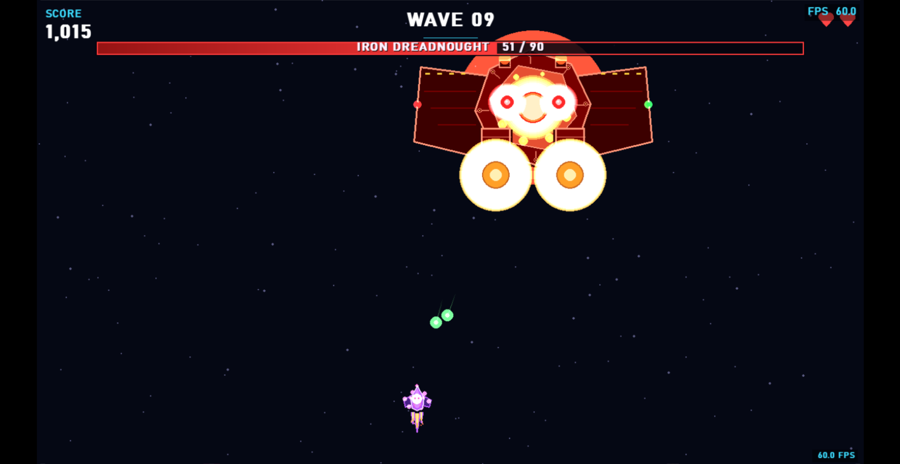
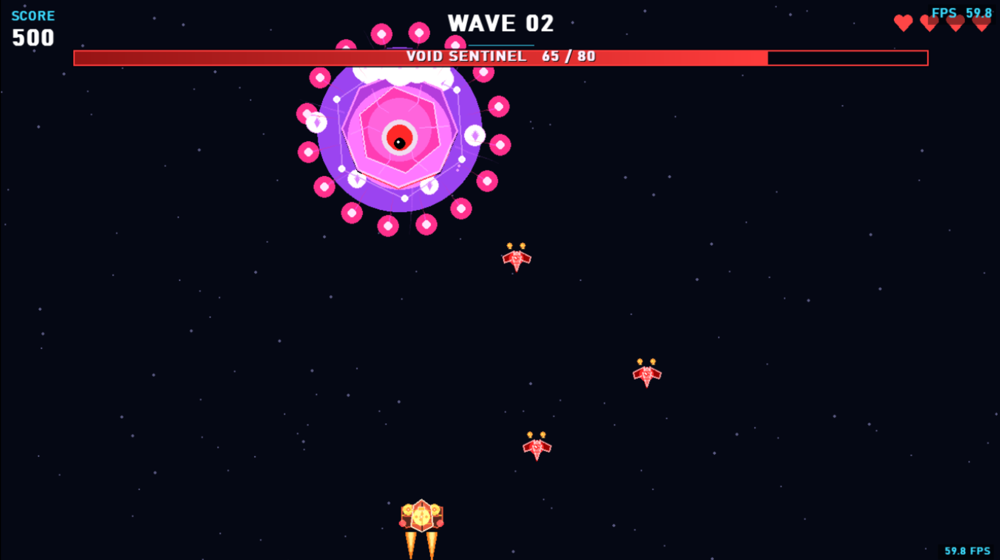
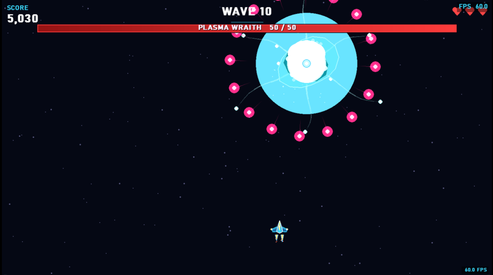
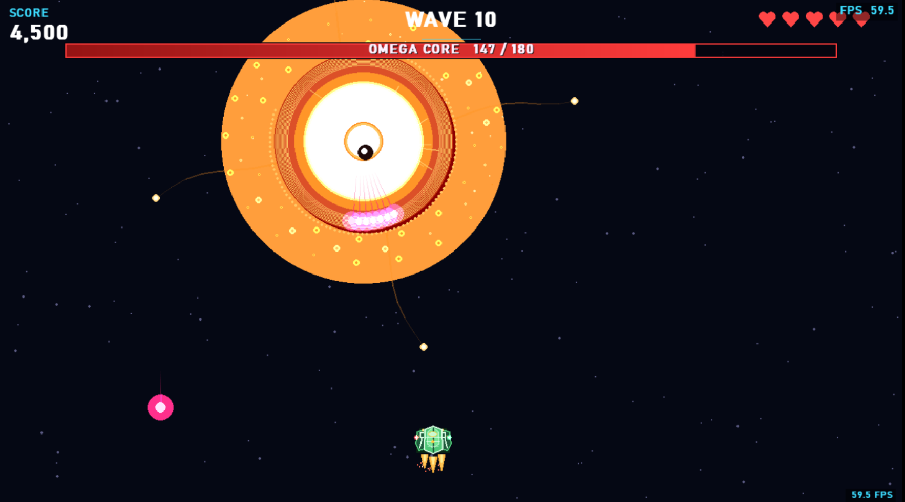
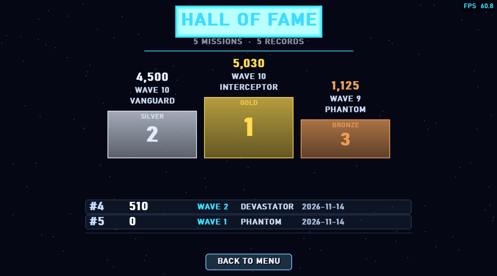

<div align="center">

[](README.md)
[](README.fa.md)

# SPACE BLASTER

**یک بازی تیراندازی فضایی (Space Shooter) سریع، هیجان‌انگیز و با دید از بالا که از صفر با پایتون و پایگیم ساخته شده است.**

*بدون هیچ فایل تصویری یا صوتی خارجی. همه چیز به صورت پروسیجرال (تولید در لحظه با کد) ساخته شده است.*


[](https://github.com/MohammadEfafi/space_blaster/actions/workflows/ci.yml)
[](https://www.python.org/)
[](https://pyga.me/)
[](https://opensource.org/licenses/MIT)

[دانلود آخرین نسخه](https://github.com/MohammadEfafi/space_blaster/releases/latest) · [گزارش باگ](https://github.com/MohammadEfafi/space_blaster/issues) · [درخواست ویژگی جدید](https://github.com/MohammadEfafi/space_blaster/issues)

</div>

---

## درباره بازی

**SPACE BLASTER** یک نسخه مدرن از بازی‌های کلاسیک آرکید است. این بازی دارای حرکت روان، انفجارهای لرزاننده صفحه و نبردهای هیجان‌انگیز با باس‌هاست. تمام بازی — گرافیک، افکت‌های ذره‌ای، رابط کاربری و افکت‌های صوتی — در لحظه اجرا و با استفاده از کد خالص تولید می‌شود.

اینکه در حال جاخالی دادن از گلوله‌های **Omega Core** هستید یا در حال رساندن امتیاز خود به صدر جدول **Hall of Fame**، هر بار بازی کردن یک آزمون برای واکنش و استراتژی شماست.

<div align="center">
  
</div>

## ویژگی‌های کلیدی

- **۴ سفینه قابل بازی:** Interceptor، Vanguard، Phantom و Devastator — هر کدام با آمار، سلاح و سبک بازی منحصربه‌فرد.
- **۸ نوع دشمن:** از پهپادهای کامیکازه سریع تا بمب‌افکن‌های سنگین و تک‌تیراندازها.
- **۴ باس غول‌پیکر:** دارای مکانیک‌های چندمرحله‌ای، الگوهای حمله منحصربه‌فرد و هشدارهای بصری داینامیک.
- **تولید پروسیجرال (Procedural):** بدون فایل `.png` یا `.wav`. همه چیز با ریاضیات کشیده شده و با امواج صوتی سنتز شده است.
- **حس مدرن بازی:** لرزش دوربین مبتنی بر تروما (Trauma-based screen shake)، مدیریت بهینه ذرات و انیمیشن‌های نرم رابط کاربری.
- **سیستم موج داینامیک:** سختی بازی به‌آرامی افزایش می‌یابد و دشمنان نخبه، موج‌های پیشرفته و باس‌های تصادفی را معرفی می‌کند.
- **جدول امتیازات ماندگار:** ذخیره‌سازی امتیاز بالا به‌صورت محلی با ردیابی ۱۰ رکورد برتر و آمار دقیق.

---

## گالری تصاویر

### ناوگان (سفینه‌ها)

<div align="center">
  
  
  <br>
  
  
</div>

### نبرد با باس‌ها

<div align="center">
  
  
  <br>
  
  
</div>

### تالار مشاهیر

<div align="center">
  
</div>

---

## نحوه بازی

### روش اول: دانلود نسخه اجرایی (ویندوز)

برای بازی نیازی به نصب پایتون ندارید!

۱. به صفحه [Releases](https://github.com/MohammadEfafi/space_blaster/releases/latest) بروید.

۲. فایل `SpaceBlaster.exe` را دانلود کنید.

۳. روی آن دابل کلیک کنید و بازی کنید!

*نکته: آنتی‌ویروس ویندوز ممکن است به دلیل PyInstaller هشدار کاذب بدهد. روی "More info" و سپس "Run anyway" کلیک کنید.*

### روش دوم: اجرا از روی سورس کد

```bash
# 1. کلون کردن مخزن
git clone https://github.com/MohammadEfafi/space_blaster.git
cd space_blaster

# 2. ساخت محیط مجازی
python -m venv .venv

# فعال‌سازی محیط مجازی
# Windows:
.venv\Scripts\activate

# Linux / macOS:
source .venv/bin/activate

# نصب وابستگی‌ها
pip install -r requirements.txt

# 3. اجرای بازی
python main.py
```

## کنترل‌ها

| **عملیات**       | **کلید**                              |
| :--------------- | :------------------------------------ |
| **حرکت**         | `W`, `A`, `S`, `D` یا کلیدهای جهت‌دار |
| **شلیک**         | `Space`                               |
| **توقف (Pause)** | `P` یا `Esc`                          |
| **تمام‌صفحه**    | `F11`                                 |

---

## معماری و تکنولوژی

این پروژه با تمرکز بسیار زیاد روی **معماری تمیز** و **کارایی (Performance)** ساخته شده است:

- **هسته بازی:** مدیر صحنه (Scene Manager) سفارشی با انتقال‌های حالت معوق (Deferred).
- **سیستم برخورد:** شبکه هش فضایی (Spatial Hash Grid) برای فاز گسترده + برخورد دایره‌ای برای فاز دقیق.
- **موتور ذرات:** معماری Object Pooling برای مدیریت هزاران ذره بدون افت فریم.
- **دوربین:** لرزش صفحه مبتنی بر تروما (روش Squirrel Eiseloh) با زوم داینامیک.
- **صدا:** سنتز صدای پروسیجرال (تولید بافرهای `.wav` در حافظه با استفاده از `math` و `array`).
- **تست:** خط لوله خودکار CI/CD با `pytest` که پایداری منطق اصلی را تضمین می‌کند.

---

## لایسنس

تحت لایسنس MIT منتشر شده است. برای اطلاعات بیشتر فایل `LICENSE` را ببینید.

<div align="center">
  <b>ساخته شده با پایتون</b>
</div>
