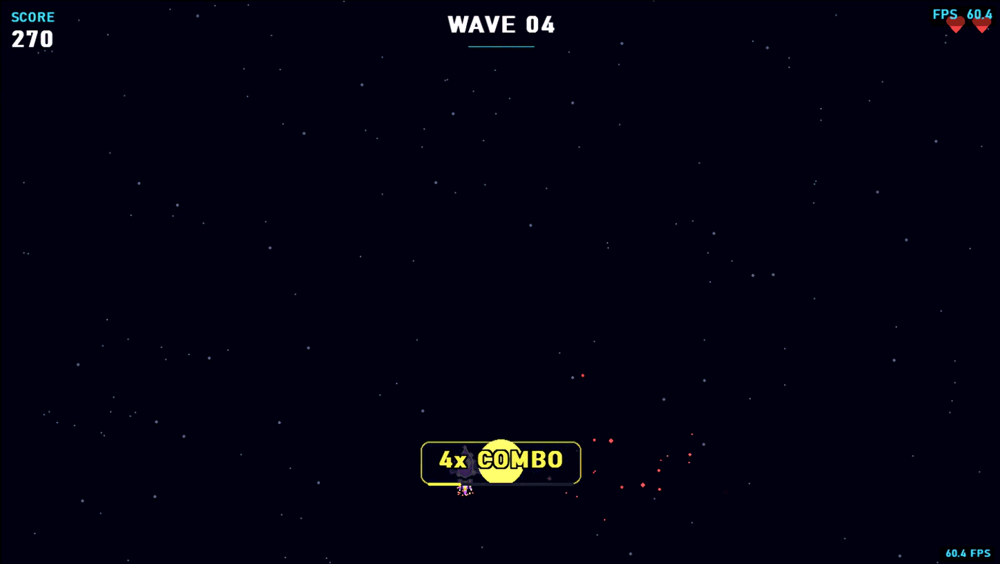
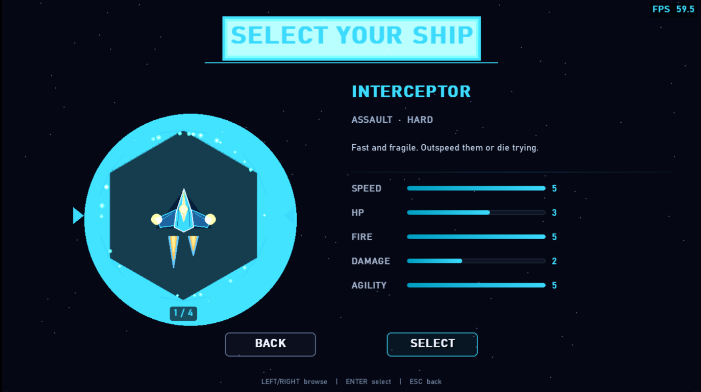
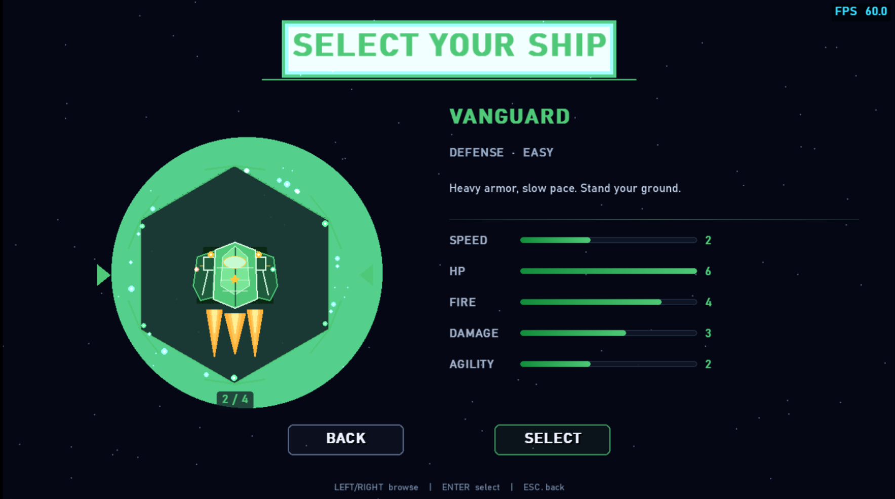
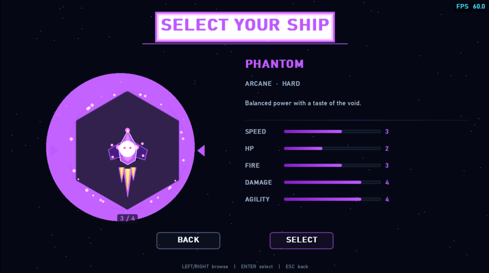
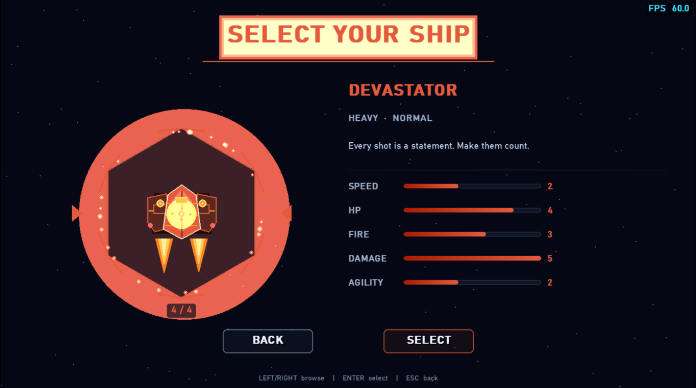
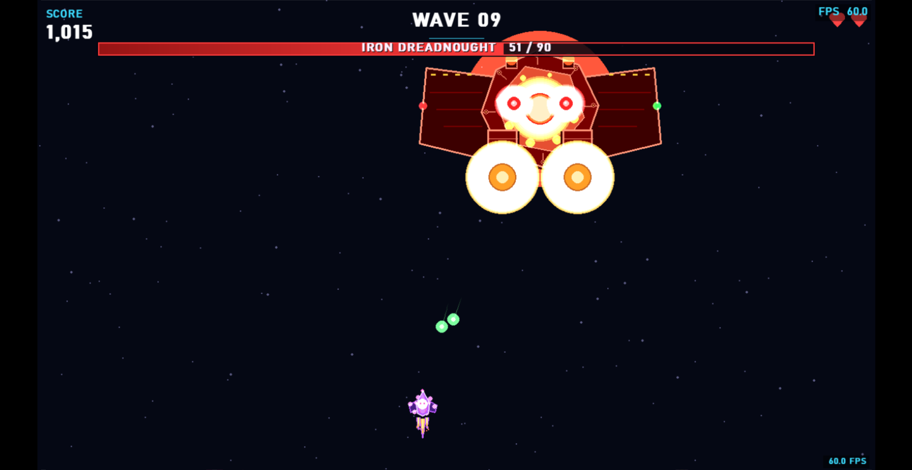
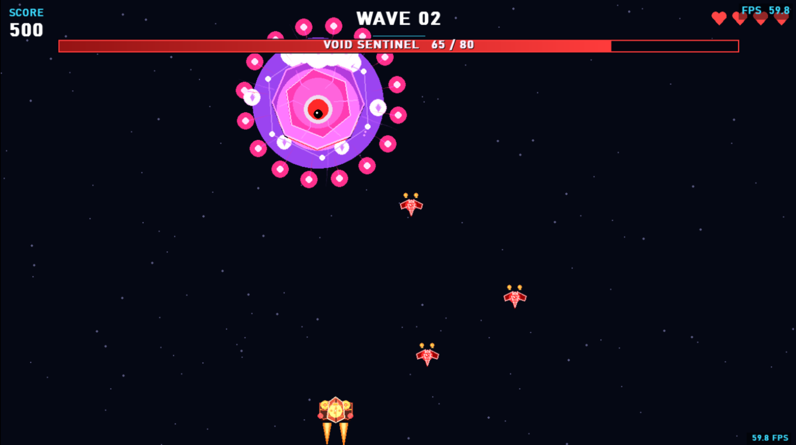
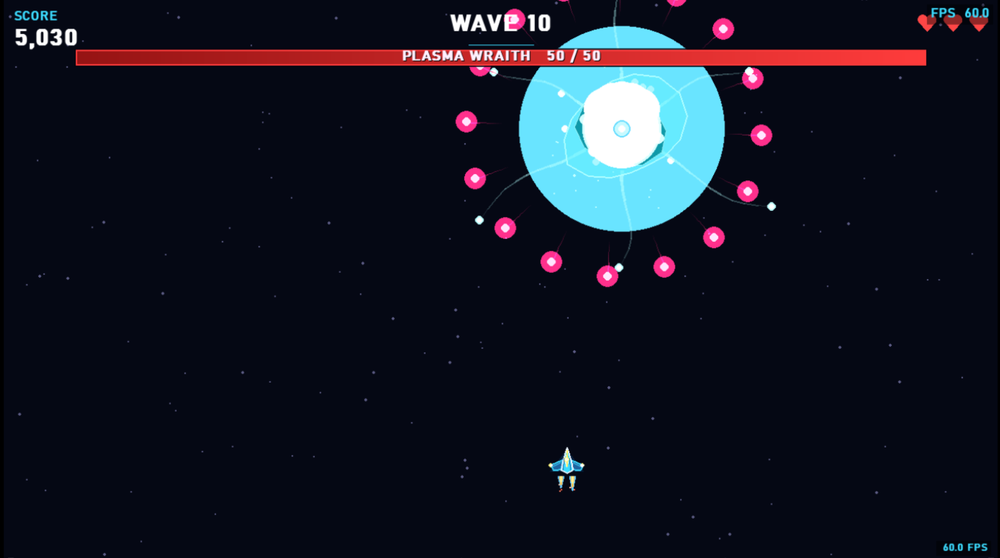
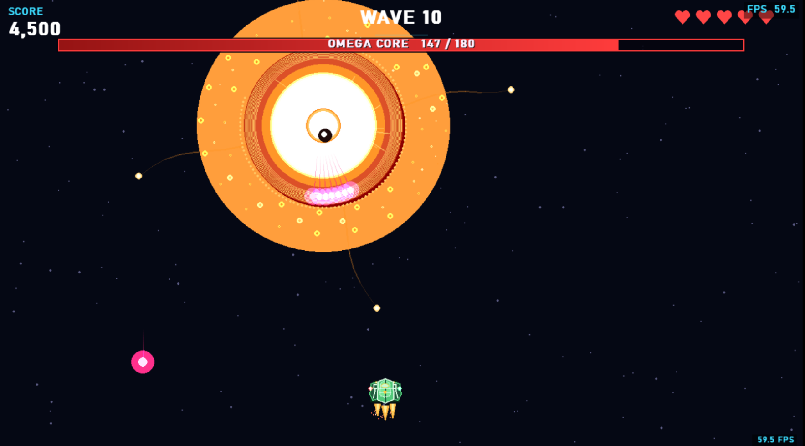
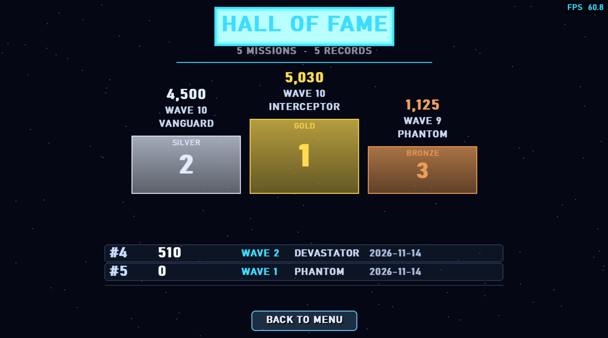

<div align="center">

🌐 **Language / زبان:**
**[🇬🇧 English (you are here)]** &nbsp;·&nbsp; [🇮🇷 فارسی — Click here](README.fa.md)

# SPACE BLASTER

**A fast-paced, action-packed top-down space shooter built from scratch with Python and Pygame.**

*No external sprites. No audio files. Everything is procedurally generated.*

[](https://github.com/MohammadEfafi/space_blaster/actions/workflows/ci.yml)
[](https://www.python.org/)
[](https://pyga.me/)
[](https://opensource.org/licenses/MIT)

<br>

### Ready to Play?
**No installation, no Python, no setup. Just download and double-click!**

<br>

<a href="https://mohammad-efafi.itch.io/space-blaster">
  
</a>

<br><br>

**Click the green button above to download**

<br>

*For Windows 10/11 • 15 MB • 100% Free*

<br>

<sub>
If itch.io is blocked in your region, use these direct mirrors:
<br>
<a href="https://gh-proxy.com/https://github.com/MohammadEfafi/space_blaster/releases/latest/download/SpaceBlaster.exe">Direct Download 1 (gh-proxy)</a>
&nbsp;·&nbsp;
<a href="https://xget.xi-xu.me/gh/MohammadEfafi/space_blaster/releases/latest/download/SpaceBlaster.exe">Direct Download 2 (xget)</a>
</sub>

<br>

[Report Bug](https://github.com/MohammadEfafi/space_blaster/issues) · [Request Feature](https://github.com/MohammadEfafi/space_blaster/issues)

</div>

---

## About the Game

**SPACE BLASTER** is a modern take on the classic arcade space shooter. It features fluid movement, screen-shaking explosions, and intense boss battles. The entire game — graphics, particle effects, UI, and sound effects — is generated at runtime using pure code.

Whether you're dodging bullet hell attacks from the **Omega Core** or pushing your score to the top of the **Hall of Fame**, every run is a test of reflexes and strategy.

<div align="center">
  
</div>

## Key Features

- **4 Unique Playable Ships:** Interceptor, Vanguard, Phantom, and Devastator — each with distinct stats, weapon loadouts, and playstyles.
- **8 Enemy Types:** From fast kamikaze drones to heavy bombers and snipers.
- **4 Epic Boss Fights:** Featuring multi-phase mechanics, unique attack patterns, and dynamic visual telegraphs.
- **Procedural Generation:** No `.png` or `.wav` files. Everything is drawn with math and synthesized via waveforms.
- **Modern Game Feel:** Trauma-based screen shake, particle pooling, hit-stun, and smooth UI animations.
- **Dynamic Wave System:** Difficulty scales smoothly, introducing elite enemies, advanced waves, and random boss encounters.
- **Persistent Leaderboard:** Local high-score saving with top-10 tracking and detailed stats.

---

## Gallery

### The Fleet

<div align="center">
  
  
  <br>
  
  
</div>

### Boss Encounters

<div align="center">
  
  
  <br>
  
  
</div>

### Hall of Fame

<div align="center">
  
</div>

---

## How to Play

### Option 1: Download the Executable (Windows)

You don't need Python to play!

1. Go to the [Releases](https://github.com/MohammadEfafi/space_blaster/releases/latest) page.
2. Download `SpaceBlaster.exe`.
3. Double-click and play!

*Note: Windows Defender might show a false positive due to PyInstaller. Click "More info" and then "Run anyway".*

### Option 2: Run from Source

```bash
# 1. Clone the repository
git clone https://github.com/MohammadEfafi/space_blaster.git
cd space_blaster

# 2. Create a virtual environment
python -m venv .venv

# Activate the virtual environment
# Windows:
.venv\Scripts\activate

# Linux / macOS:
source .venv/bin/activate

# 3. Install dependencies
pip install -r requirements.txt

# 4. Launch the game
python main.py
```

## Controls

| **Action** | **Key** |
| :--- | :--- |
| **Movement** | `W`, `A`, `S`, `D` or Arrow Keys |
| **Shoot** | `Space` |
| **Pause** | `P` or `Esc` |
| **Fullscreen** | `F11` |

---

## Architecture & Technology

This project is built with a strong focus on **clean architecture** and **performance**:

- **Game Core:** Custom Scene Manager with deferred state transitions.
- **Collision System:** Spatial Hash Grid for broad-phase detection and circle-based collision for narrow-phase detection.
- **Particle Engine:** Object Pooling architecture to manage thousands of particles without frame drops.
- **Camera:** Trauma-based screen shake (Squirrel Eiseloh method) with dynamic zoom.
- **Audio:** Procedural sound synthesis (generating `.wav` buffers in memory using `math` and `array`).
- **Testing:** Automated CI pipeline with `pytest` to ensure the stability of core game logic.

---

## License

Released under the MIT License. See the `LICENSE` file for more information.

<div align="center">
  <b>Made with Python</b>
</div>
